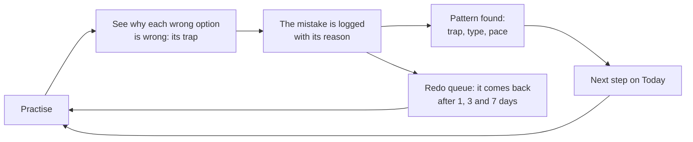
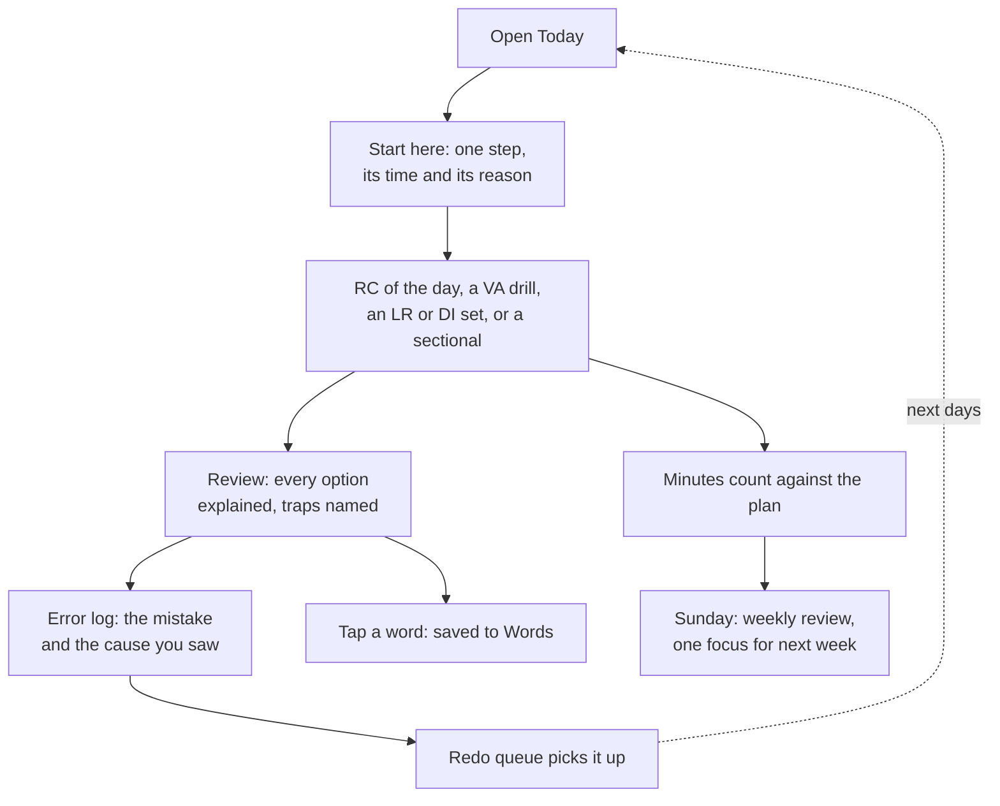
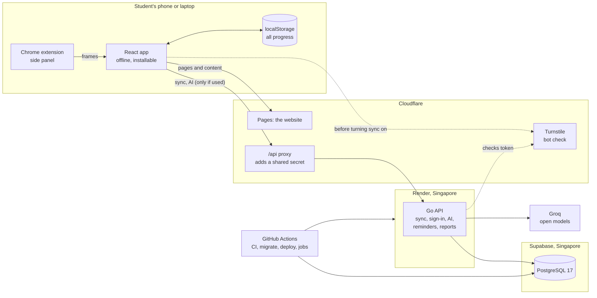
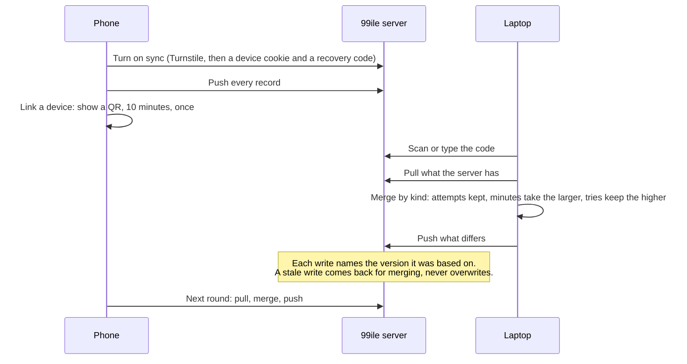

# 99ile: a free CAT coach that learns from every mistake

**[99ile.in](https://99ile.in)** · free, no sign-up, works offline, on a phone or a laptop · [Chrome extension](https://99ile.in/chrome)

99ile helps students prepare for CAT, India's entrance exam for the IIMs and other MBA schools. It plans each day around the time you actually have, gives you exam-style practice where every option is explained, and keeps bringing your own mistakes back until they stop happening.

**Live now:** VARC and DILR. **Next:** Quant, from January 2027.

---

## The problem

Preparing for CAT on your own is hard in ways that have little to do with how many questions you can find:

| What students face | Why it hurts |
|---|---|
| **No plan.** Hundreds of free resources, no order, no idea what to do today | Hours go into choosing instead of studying; preparation stalls after a few weeks |
| **The same mistakes, again.** A wrong answer is seen once, then forgotten | Scores plateau, because the same few traps (extreme wording, out of scope, a misread clue) keep costing marks |
| **Answer keys without reasons.** "C is correct" says nothing about why B looked right, or how a DILR grid was reached | The trap that caught you catches you again |
| **Coaching is expensive** | Many students prepare alone, or with a mock series only |
| **Little time, often on a phone** | Working professionals get 45 to 90 minutes a weekday, on a cheap phone on 4G |
| **Sign-ups and paywalls in the way** | Students want to start practising, not create an account |

## How 99ile solves it

Other CAT sites compete on the number of questions. 99ile is built around one loop, and every feature either feeds it or makes it easier to start the day:



- **A plan that fits your day.** Answer four questions in a minute; the plan splits your weekday and weekend time across the sections, leans towards the one you find hardest, and catches up what you missed.
- **Every option explained.** Each wrong option is labelled with the trap it sets, and RC questions point at the line in the passage that decides them.
- **Method you can see.** DILR Replay shows a set being solved one deduction at a time, with the number of possible cases falling at each step.
- **Mistakes come back.** Missed questions return on a schedule until you get them right three times in a row, and the Error log finds the patterns behind them.
- **Evidence, not hype.** A recommendation says what it is based on ("7 of your last 12 inference misses were extreme wording") and stays quiet until there is enough data.
- **Yours, without an account.** Everything works as a guest and offline. Sync between your phone and laptop needs no sign-up; Google sign-in is optional.

### A day with 99ile



### Who it is for

- **The self-studier.** A final-year student or a fresher preparing alone, with no coaching or only a mock series.
- **The working professional.** Under an hour on a weekday, more at the weekend, often on a phone.
- **The coaching student.** Already has classes and mocks; uses 99ile for daily VARC and DILR, the redo queue and to analyse mocks properly.

---

## What you can do today

### Plan your day
- **A one-minute setup.** How your days look (studying, working or both), the time you can give on a weekday and at the weekend, where you stand, and the section that feels hardest. The plan and your first step follow from the answers, with one line on why.
- **Today.** A timetable built from your phase and your minutes per section; a missed core task comes back as a catch-up.
- **Start here.** One next step at the top of Today, with its time and the reason, and "Something else" for the next one.
- **Plan and time.** Five phases to your CAT year (Foundation, Build, Apply, Mock phase, Taper). Minutes per section for weekdays and weekends, a different time per day of the week, a single day changed, or a whole date range lowered for an exam week. A target percentile.
- **Focus timer.** Start it on any block; it keeps running across pages, suggests a break every 25 minutes and records real minutes against the plan.
- **Reminders.** A daily study reminder by phone notification or email, and the weekly review by email, each with a one-tap unsubscribe.

### Practise VARC
- **RC practice.** 55 original reading comprehension sets in 9 genres, at CAT length, 4 or 5 questions each, including a collection in the CAT pattern. Every option is explained and every wrong one carries its trap label. An RC of the day with an archive.
- **Prove it from the passage.** After choosing an option, tap the line that settles it; the review says whether you found it and always shows the deciding line.
- **VA drill.** 80 original paragraphs, each giving all four CAT question types: para summary, sentence insertion, odd sentence out and para jumbles.
- **Critical reasoning drill.** 30 original questions in the six types XAT asks: assumption, strengthen, weaken, inference, flaw and paradox.
- **Timed VARC sectional.** 40 minutes, a CAT-style palette and mark for review; a reload never loses it.
- **Summaries.** After an RC set, sum up the passage in 25 words, compare it with a model summary and a four-point check, and, signed in, get feedback on each point. All in the Reading journal.
- **Reading speed test.** Words per minute, with recall questions so speed does not come at the cost of understanding.

### Practise DILR
- **LR sets.** 47 original logical reasoning sets in 13 kinds (arrangement, scheduling, selection, distribution, tournaments, routes, Venn and more), each with a review of the set once you finish.
- **DI sets.** 12 data interpretation sets at CAT level, with charts drawn from each set's numbers, CAT's on-screen calculator, and answers checked by code. More every week to mid-January.
- **Set Selection Arena.** Five sets, 40 minutes: choose which to attempt, as in the exam, then see how your choices and your time went.
- **DILR Replay.** Watch a set solved one deduction at a time, step through it, or solve it yourself. Any replay becomes a short video clip to share.
- **Short drills.** Clue translator (80 clues: "only if", "unless", "not both"), Must, could, cannot, and First move (which clue to start with, and why).

### Practise from what you read
- **Article to RC set.** Paste an essay or editorial, or open it with the Chrome extension, and get four CAT-style questions on it. The passage stays highlighted on the page while you answer in the side panel. Needs Google sign-in; an article someone has practised before is ready at once.
- **Words from anywhere.** Select a word on any page to see its meaning in context and save it to your Words.

### Learn from your mistakes
- **Redo queue.** Every miss returns after 1, 3 and 7 days, until it is right three times in a row.
- **Error log.** Wrong answers are logged on their own, with the option you chose, its trap and the right reasoning. Add the cause (misread, missed a qualifier, fell for a trap, careless slip) and the log finds your patterns: "4 of your last 6 inference misses fell for extreme wording".
- **From a mistake back to its question.** "Try it again" asks it with the answer hidden, and afterwards shows what you thought last time next to the right reasoning.
- **"Not sure."** Mark a guess; a lucky right answer comes back once for a second look.
- **Words.** Saved words come back as spaced-repetition flashcards.

### Track your progress
- **Report card.** Accuracy by question type, RC question kind, genre and difficulty; reading pace over time; the traps that cost you most.
- **Three questions answered.** Am I improving? Are my weak spots getting fixed? Am I exam ready?
- **History.** What you did each day: every set with its score and time, and minutes studied.
- **Mocks and target.** Log mocks, see the trend against your target band, and turn any score into an estimated percentile from published tables.
- **Mock analysis.** A guided 15-minute review after any mock or sectional: what went wrong and why, the doable skips, where the marks went, at most three actions.
- **Weekly review.** From Saturday evening: the week in numbers, what improved or slipped, the trap that cost most, and one focus for next week shown on Today.

### Learn
- **Guides** for every VARC question type and DILR set type: the method, the traps, a worked example and where to practise.
- **Curated free resources**, real CAT papers linked from their free sources, topper stories, the CAT pattern and timeline, and other MBA exams.

### Keep your progress, on every device
- **Works offline and installs as an app** on Android, iPhone, iPad and desktop.
- **Your data stays with you.** Progress is saved in your browser first; backup to a file and restore it any time; two tabs at once never overwrite each other.
- **Sync between devices, no sign-up.** Link your phone by scanning a QR code or typing an 8-character code; a recovery code brings it all back on a new device. Or sign in with Google instead of keeping a code.
- **Download what the server has, or delete it everywhere**, from Settings.
- **Privacy in plain words** at [/privacy](https://99ile.in/privacy): what is stored, where, for how long, and your rights.

---

## What is coming

| When | What it adds |
|---|---|
| **December 2026 to January 2027** | A home page that picks up where you left off; restart your plan after a break; an inbox in the app; a daily DILR puzzle; DI sets growing to 24 |
| **January to March 2027** | **Quant:** concepts, set types and timed drills, with "estimate first" and "why this method" built into the player |
| **March 2027** | A mock upgrade, flashcards from your mistakes, a check on whether a fix held, and part 2 of the plan that fits you (a commute set, a diagnostic for repeaters) |
| **Spring 2027** | Study groups and discussion under each question, with moderation first |

The live list is on the [roadmap page](https://99ile.in/roadmap).

---

## How it is built

### Principles
1. **No sign-up to start.** Everything works as a guest, offline, on one device. Sync, sign-in and AI are additions, never a gate to practice.
2. **Code counts, AI explains.** Scores, schedules, answer checks and recommendations come from tested code. AI is used only where the answer differs for each student (your summary, your article), its output is checked against a schema, and practice never waits for it.
3. **Original content, checked by tests.** Every answer key is tested before it ships; DILR answers are computed by a solver, and new DI sets are solved by two independent checkers. Real CAT papers are linked, never copied.
4. **Fast on a cheap phone on 4G.** The first download has a budget (main script 155 KB gzipped, about 129 KB today) that CI enforces, and a plain frame paints before any script runs.
5. **Free to run.** Every service is on a free plan.

### Tech stack

| Part | Built with |
|---|---|
| Website | React 19, TypeScript, Vite, React Router, Tailwind CSS 4, shadcn/ui (Radix), self-hosted fonts |
| Offline | A small service worker written at build time; a web app manifest |
| Data on the device | localStorage, with versioned saves merged between tabs |
| Tests | Vitest, about 1,600 tests: planner, practice content and answer keys, solvers, sync, merging, the first download |
| API | Go 1.27, standard library HTTP router, pgx, goose migrations |
| Database | PostgreSQL 17 on Supabase (Singapore) |
| Hosting | Cloudflare Pages (site and the `/api` proxy), Render (API, Singapore) |
| Sign-in and bot check | Google sign-in (optional), Cloudflare Turnstile |
| AI | Open models on Groq, tried in order with fallback on limits (`server/internal/ai/models.json`); Ollama in development |
| Email and push | Gmail SMTP for reminders and the weekly review, Web Push for phone notifications |
| Chrome extension | Manifest V3 side panel, built with esbuild (`extension/`) |
| Delivery | GitHub Actions: checks on every change; migrate, then deploy the exact commit; daily clean-up and report digest |

### Architecture



- **The website works on its own.** Practice content ships with the site and loads one file at a time; nothing waits for a server.
- **The server is for what needs one:** sync, Google sign-in, AI, reminders and problem reports. It is reached only through the site's own `/api` proxy, so the device cookie stays first-party and no other site can call it.
- **Content is in the repository, not the database.** RC sets, VA paragraphs, CR questions, LR and DI sets and the DILR drills are JSON files checked by tests on every change.
- **The extension holds no logic of its own.** Its side panel shows `99ile.in/panel`, so a website deploy updates the panel without a store review; the extension only reads the page and highlights the passage.

### How sync works



- **No account needed.** An anonymous identity holds the progress; each browser is a device with a random cookie, stored on the server only as a hash, like the recovery and link codes. Google sign-in, when used, ties that identity to an email.
- **Nothing is overwritten blind.** The server orders writes and checks the version each one was based on; one student's writes go one at a time, so a device never misses a row.
- **Offline first.** Every change is saved on the device first and synced later; a failed round waits and tries again, never a popup.
- **Privacy.** Network addresses are kept only as a keyed hash in the security log. Export and delete are one tap each.

### AI
AI is used for jobs tied to your own work, never as a general chatbot: summary feedback, questions on an article you chose, and a word's meaning in its sentence. The API keys stay on the server, every answer must pass a schema check before it is shown, the result records the model and prompt version, answers are cached so the same request is never paid twice, and there are daily caps per student. New AI answers need Google sign-in, so one person cannot collect many caps. Each feature has a path that works without it: the model summary and self-check, the library of written sets.

---

## Run it locally

```bash
npm install
npm run dev        # the site on http://localhost:5173
npm test           # all tests
npm run build      # production build in dist/
npm run size       # the first-download budget
```

The API (optional: sync, sign-in, AI, reminders):

```bash
cd server
cp .env.example .env
make run           # Postgres 17 in Docker on port 5433, then the API on http://localhost:8080
```

With both running, `npm run dev` shows Sync in Settings and forwards `/api` to the API. See [server/README.md](server/README.md) for the database, migrations and tests.

The Chrome extension:

```bash
npm run ext:dev    # extension/dist for "Load unpacked" in chrome://extensions
npm run ext:store  # the zip for the Chrome Web Store
```

See [extension/README.md](extension/README.md).

### Project layout

```
src/
  pages/          one file per route; pages/panel/ is the extension's side panel
  components/     layout, page building blocks (kit.tsx), shadcn/ui parts (ui/)
  practice/       RC, VA, CR, LR and DI engines, solvers, daily picks, redo queue, reports
  planner/        fits the day's blocks into your minutes; fit.ts turns the setup into a plan
  sections/       one folder per CAT section (VARC and DILR live; Quant next)
  lib/            saved state, two-tab saving, sync client, AI client, dates, reload after a deploy
  data/           exam dates and phases, updates, other exams, guides, stories, roadmap
content/          RC sets, VA paragraphs, CR questions, LR and DI sets, DILR drills, as JSON
extension/        the Chrome extension (side panel, page reader, "Add to RC set")
functions/        the Cloudflare Pages /api proxy
server/           the Go API: migrations, sync, sign-in, AI, reminders, export and delete
pwa/sw.js         service worker template, filled in at build time
docs/             plan, feature specs, architecture, analysis and design notes
```

### Adding content
- **RC set:** add it to the topic file in `content/rc/`, with 4 or 5 questions. Each option has `t` (text), `why` and a `trap` on every wrong one; `answer` is the index of the one without a trap.
- **Critical reasoning question:** add to `content/cr/items.json` in the same option format, with `type`, `stimulus`, its `conclusion` and a one-line `takeaway`.
- **VA paragraph:** add to `content/va/`. Each paragraph becomes a para summary, a para jumble, an odd sentence out and a sentence insertion.
- **LR or DI set:** add to the file for its kind in `content/lr/`, in the format in [docs/content/lr-format.md](docs/content/lr-format.md). Only original sets, or sets used with permission.
- Give new RC sets and VA paragraphs `since: "YYYY-MM-DD"` (the day after publishing), then run `npm run catalog`. `npm test` checks every answer key; have a second person check new content before it ships.
- **An update:** add it at the top of `src/data/updates.ts`; use `status: "official"` only once the exam body has published it.

### Checks and deploy
- **CI** runs on every pull request and push to `main`: typecheck, all tests, a production build, the content catalog check, the size budget, and for the API: vet, formatting, race-checked tests against a real Postgres, and the Docker image.
- **The site** is built and published by Cloudflare Pages on every push to `main`, with a preview link for every pull request. Built files have hashed names; the browser checks them with Cloudflare on each visit and the service worker keeps them for repeat visits. The service worker never stores or serves a page in place of a code file, and a page that fails to load a file after a deploy reloads once to get the new version.
- **The API** deploys after CI passes, and only when `server/` changed: migrations run first, then Render deploys that exact commit, and the workflow waits until the new version answers.

---

## Contact

Questions, privacy requests or a problem with a question: **[99ile.team@gmail.com](mailto:99ile.team@gmail.com)**, or "Report a problem" under any question in the app.
