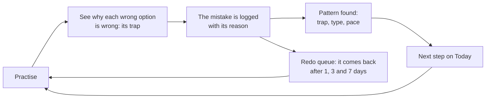
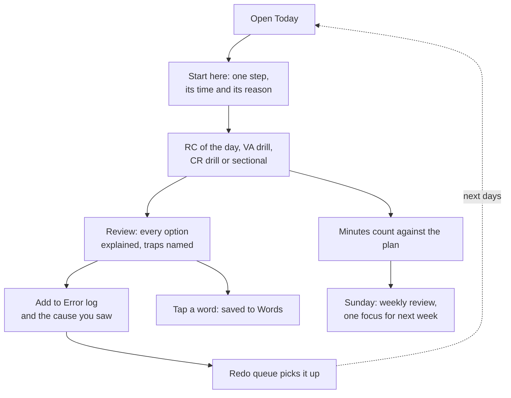
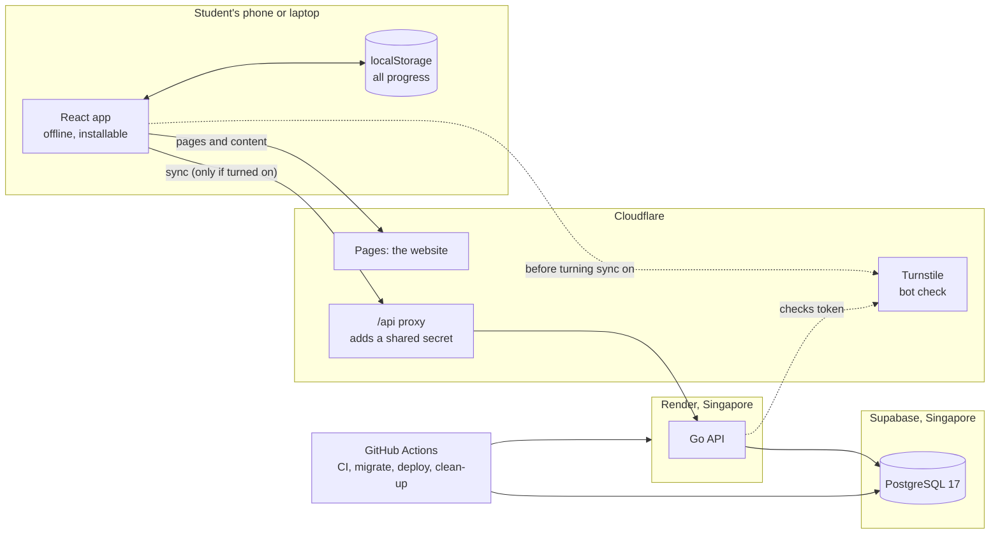
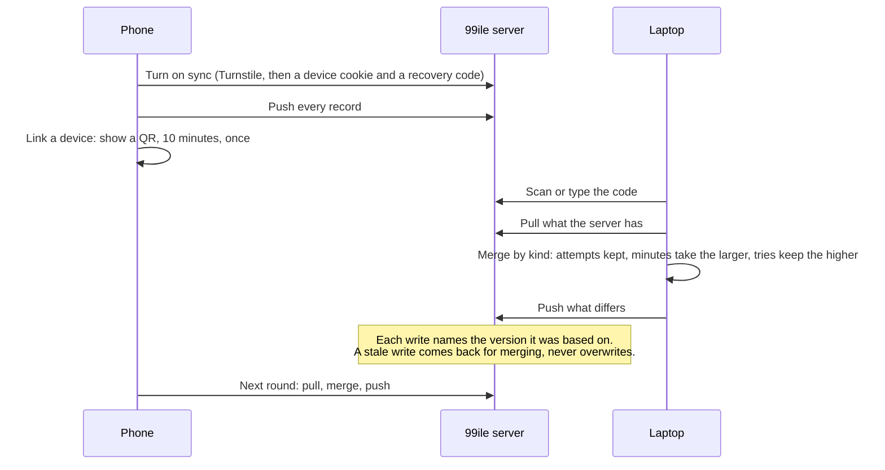

# 99ile: a free CAT coach that learns from every mistake

**[99ile.pages.dev](https://99ile.pages.dev)** · free, no sign-up, works offline, on a phone or a laptop.

99ile helps students prepare for CAT, India's entrance exam for the IIMs and other MBA schools. It plans each day around the time you actually have, gives you exam-style practice where every option is explained, and keeps bringing your own mistakes back until they stop happening.

---

## The problem

Preparing for CAT on your own is hard in ways that have little to do with how many questions you can find:

| What students face | Why it hurts |
|---|---|
| **No plan.** Hundreds of free resources, no order, no idea what to do today | Hours go into choosing instead of studying; preparation stalls after a few weeks |
| **The same mistakes, again.** A wrong answer is seen once, then forgotten | Scores plateau, because the same few traps (extreme wording, out of scope, a misread question) keep costing marks |
| **Answer keys without reasons.** "C is correct" says nothing about why B looked right | The trap that caught you catches you again |
| **Coaching is expensive** | Many students prepare alone, or with a mock series only |
| **Little time, often on a phone** | Working professionals get 60 to 90 minutes a weekday, on a cheap phone on 4G |
| **Sign-ups and paywalls in the way** | Students want to start practising, not create an account |

## How 99ile solves it

Other CAT sites compete on the number of questions. 99ile is built around one loop, and every feature either feeds it or makes it easier to start the day:



- **A plan that fits your day.** Tell it your minutes; it builds today's timetable from your phase of preparation and catches up what you missed.
- **Every option explained.** Each wrong option is labelled with the trap it sets, so you learn why it looked right.
- **Mistakes come back.** Missed questions return on a schedule until you get them right three times in a row, and the Error log finds the patterns behind them.
- **Evidence, not hype.** A recommendation says what it is based on ("7 of your last 12 inference misses were extreme wording") and stays quiet until there is enough data.
- **Yours, without an account.** Everything works as a guest and offline. Sync between your phone and laptop needs no sign-up.

### A day with 99ile



### Who it is for

- **The self-studier.** A final-year student or a fresher preparing alone, with no coaching or only a mock series.
- **The working professional.** An hour on a weekday, more at the weekend, often on a phone.
- **The coaching student.** Already has classes and mocks; uses 99ile for daily VARC, the redo queue and to analyse mocks properly.

---

## What you can do today

### Plan your day
- **Today.** A timetable built from your phase and your minutes, per section; a missed core task comes back as a catch-up; must-do links; an article summary sheet.
- **Start here.** One next step at the top of Today, with its time and the reason, and "Something else" for the next one.
- **Plan and time.** Five phases to CAT 2027 (Foundation, Build, Apply, Mock phase, Taper). Minutes per weekday and weekend, a different time per day of the week, a single day changed (rest, 30 minutes to 3 hours, or a custom number), a whole date range lowered for an exam week. A target percentile.
- **Focus timer.** Start it on any block; it keeps running across pages, suggests a break every 25 minutes and records real minutes against the plan.
- **Daily study reminder.** One tap adds a repeating event to Google, Apple or Outlook calendar.

### Practise
- **RC practice.** 45 original reading comprehension sets in 8 genres, 4 or 5 questions each. Every option is explained and every wrong one carries its trap label. An RC of the day with an archive.
- **RC library.** Every set with your best score and last attempt.
- **VA drill.** 80 original paragraphs, each giving all four CAT question types: para summary, sentence insertion, odd sentence out and para jumbles. A daily mix or one type at a time.
- **Critical reasoning drill.** 30 original questions in the six types XAT asks: assumption, strengthen, weaken, inference, flaw and paradox.
- **Timed VARC sectional.** 40 minutes, 4 RCs and 8 VA questions, a CAT-style palette and mark for review; a reload never loses it.
- **Reading speed test.** Words per minute, with two recall questions so speed does not come at the cost of understanding.
- **Real CAT papers.** Past papers linked from their free, legitimate sources.
- **"Not sure."** Mark a guess; a lucky right answer comes back once for a second look.
- **Safe to leave and come back.** Leaving an unfinished set asks first; a half-done set is kept for a day.
- **Report a problem** on any question, in one tap.

### Learn from your mistakes
- **Redo queue.** Every miss returns after 1, 3 and 7 days, until it is right three times in a row.
- **Error log.** Entries are made from practice in one tap, with the option you chose, its trap and the right reasoning. Add the cause (misread, missed a qualifier, fell for a trap, careless slip…) and the log finds your patterns: "4 of your last 6 inference misses fell for extreme wording".
- **Summaries.** After an RC set, sum up the passage in 25 words and compare it with a model summary and a four-point check; also for outside articles. All in the Reading journal.
- **Words.** Tap a word in a reviewed passage to save it; spaced-repetition flashcards bring it back.

### Track your progress
- **Report card.** Accuracy by question type, RC question kind, genre and difficulty; reading pace over time; the traps that cost you most.
- **Three questions answered.** Am I improving? Are my weak spots getting fixed (each measured before and after)? Am I exam ready?
- **Mocks and target.** Log mocks, see the trend against your target band, and turn any score into an estimated percentile from published tables.
- **Mock analysis.** A guided 15-minute review after any mock or sectional: what went wrong and why, the doable skips, where the marks went, at most three actions.
- **Weekly review.** From Saturday evening: the week in numbers, what improved or slipped, the trap that cost most, and one focus for next week shown on Today.
- **Streak.** Any day with activity counts, with two shields a month for days you miss.

### Learn VARC
- **Guides** for every question type: the method, the traps, a worked example and where to practise.
- **About 130 curated free resources**: question banks by type, a reading rotation, topper data.
- **Explore**: important updates (marked official or expected), the CAT pattern and yearly timeline, other MBA exams, guides, topper stories and the roadmap.

### Keep your progress, on every device
- **Works offline and installs as an app** on Android, iPhone, iPad and desktop, with a step-by-step guide for each browser.
- **Your data stays with you.** Progress is saved in your browser; 99ile asks the browser to keep it and warns about Safari's 7-day rule on iPhone.
- **Backup** to a file and restore it, any time.
- **Two tabs at once** never overwrite each other's work.
- **Sync between devices, no sign-up.** Turn it on, then link your phone by scanning a QR code or typing an 8-character code. Everything syncs: attempts, logs, words, ticks, settings. A recovery code brings it all back on a new device. See your devices, remove one, or turn sync off on one device only.
- **Download what the server has, or delete it everywhere**, from Settings.
- **Privacy in plain words** at [/privacy](https://99ile.pages.dev/privacy): what is stored, where, for how long, and your rights.

---

## What is coming

| Next | What it adds |
|---|---|
| **From a mistake back to its question** (built, shipping this week) | "See the question" opens your old attempt at that question; "Try it again" asks it with the answer hidden, then shows **what you thought last time** next to the right reasoning. A submitted set also stays on its review after a reload |
| **History** | What you did each day: every passage with its score and time, minutes studied, a 12-week strip; find a passage you did a month ago |
| **Error log filters** | By type, trap and cause, and "still happening" versus "fixed"; Progress weak spots lead straight to those mistakes |
| **Weak-spot drill** | "10 minutes on inference with extreme wording", from your own misses plus new questions of that kind |
| **Passage recap before a retry** | A three-line reminder of the passage before you re-solve an old question |
| **Explain my mistake (AI)** | Two to four sentences on the gap between your option and the right one, pointing at the passage |
| **Summary feedback (AI)** | Your summary checked against the four points, one line each |
| **Quiz me on this article (Chrome extension, AI)** | Reading an editorial on any site? Tap 99ile and get CAT-style questions on that passage, to check you understood it, not just read it |
| **Report a problem, to us directly** | Without a GitHub account |
| **Google sign-in (optional)** | Your synced progress tied to your Google account instead of a recovery code |
| **DILR and Quant** | Concepts, set types, a set player with MCQ and TITA questions, timed drills and their own plans |

Later: a daily RC leaderboard, flashcards from mistakes, a working-professional mode, a past-paper catalogue by question type, a B-school calculator, Hindi explanations. The live list is on the [roadmap page](https://99ile.pages.dev/roadmap).

---

## How it is built

### Principles
1. **No sign-up to start.** Everything works as a guest, offline, on one device. Sync and AI are additions, never a gate.
2. **Code counts, AI explains.** Scores, schedules and recommendations come from tested code. AI only explains and drafts, its output is checked, and practice never waits for it.
3. **Original content, checked by tests.** Every answer key is tested before it ships. Real CAT papers are linked, never copied.
4. **Fast on a cheap phone on 4G.** The first download has a budget (main script 150 KB gzipped) that CI enforces.
5. **Free to run.** Every service is on a free plan.

### Tech stack

| Part | Built with |
|---|---|
| Website | React 19, TypeScript, Vite, React Router, Tailwind CSS 4, shadcn/ui (Radix), self-hosted fonts |
| Offline | A small service worker written at build time; a web app manifest |
| Data on the device | localStorage, with versioned saves merged between tabs |
| Tests | Vitest (about 770 tests: planner, practice content and answer keys, sync, merging) |
| API | Go 1.27, standard library HTTP router, pgx, goose migrations |
| Database | PostgreSQL 17 on Supabase (Singapore), one schema per area (`account`, `sync`, `audit`) |
| Hosting | Cloudflare Pages (site and the `/api` proxy), Render (API, Singapore) |
| Bot check | Cloudflare Turnstile |
| Delivery | GitHub Actions: checks on every change; migrate, then deploy the exact commit; daily clean-up |
| AI (planned) | Groq in production and Ollama in development, behind the Go API |

### Architecture



- **The website works on its own.** Practice content ships with the site and loads one file at a time; nothing waits for a server.
- **The server is only for sync** (and AI later). It sees requests only through the site's own `/api` proxy, so the device cookie stays first-party and no other site can call it.
- **Content is in the repository, not the database.** RC sets, VA paragraphs and CR questions are JSON files checked by tests on every change.

### How sync works



- **No account.** An anonymous identity holds the progress; each browser is a device with a random cookie, stored on the server only as a hash, like the recovery and link codes.
- **Nothing is overwritten blind.** The server orders writes and checks the version each one was based on; one student's writes go one at a time, so a device never misses a row.
- **Offline first.** Every change is saved on the device first and synced later; a failed round waits and tries again, never a popup.
- **Privacy.** No name, email or phone number. Network addresses are kept only as a keyed hash in the security log. Export and delete are one tap each.

### AI, when it comes
AI is planned for jobs tied to your own practice, never a general chatbot. The API key stays on the server, every answer must pass a schema check before it is shown, each result records the model and prompt version, students can flag a bad answer, and there are daily caps. Every AI feature has a fallback that works without it: the written explanation, the self-check, the library.

---

## Run it locally

```bash
npm install
npm run dev        # the site on http://localhost:5173
npm test           # all tests
npm run build      # production build in dist/, with the size budget in npm run size
```

The API (optional, only for sync):

```bash
cd server
cp .env.example .env
make run           # Postgres 17 in Docker on port 5433, then the API on http://localhost:8080
```

With both running, `npm run dev` shows Sync in Settings and forwards `/api` to the API. See [server/README.md](server/README.md) for the database, migrations and tests.

### Project layout

```
src/
  pages/          one file per route
  components/     layout, page building blocks (kit.tsx), sync screens, shadcn/ui parts (ui/)
  practice/       RC, VA and CR engines, daily picks, redo queue, error links, reports
  planner/        fits the day's blocks into your minutes
  sections/       one folder per CAT section (VARC live; DILR and Quant next)
  lib/            saved state, two-tab saving, sync client, dates, install and calendar helpers
  data/           exam dates and phases, updates, other exams, guides, stories, roadmap
content/          RC sets, VA paragraphs and CR questions as JSON
functions/        the Cloudflare Pages /api proxy
server/           the Go API: migrations, sync, linking devices, export and delete
pwa/sw.js         service worker template, filled in at build time
```

### Adding content
- **RC set:** add it to the topic file in `content/rc/`, with 4 or 5 questions. Each option has `t` (text), `why` and a `trap` on every wrong one; `answer` is the index of the one without a trap.
- **Critical reasoning question:** add to `content/cr/items.json` in the same option format, with `type`, `stimulus`, its `conclusion` and a one-line `takeaway`.
- **VA paragraph:** add to `content/va/paragraphs-2.json`. Each paragraph becomes a para summary, a para jumble, an odd sentence out and a sentence insertion.
- Give new RC sets and VA paragraphs `since: "YYYY-MM-DD"` (the day after publishing), then run `npm run catalog`. `npm test` checks every answer key; have a second person check new content before it ships.
- **An update:** add it at the top of `src/data/updates.ts`; use `status: "official"` only once the exam body has published it.

### Checks and deploy
- **CI** runs on every pull request and push to `main`: typecheck, all tests, a production build, the content catalog check, the size budget, and for the API: vet, formatting, race-checked tests against a real Postgres, and the Docker image.
- **The site** is built and published by Cloudflare Pages on every push to `main`, with a preview link for every pull request.
- **The API** deploys after CI passes, and only when `server/` changed: migrations run first, then Render deploys that exact commit, and the workflow waits until the new version answers.

---

## Contact

Questions, privacy requests or a problem with a question: **[99ile.team@gmail.com](mailto:99ile.team@gmail.com)**, or "Report a problem" under any question in the app.
